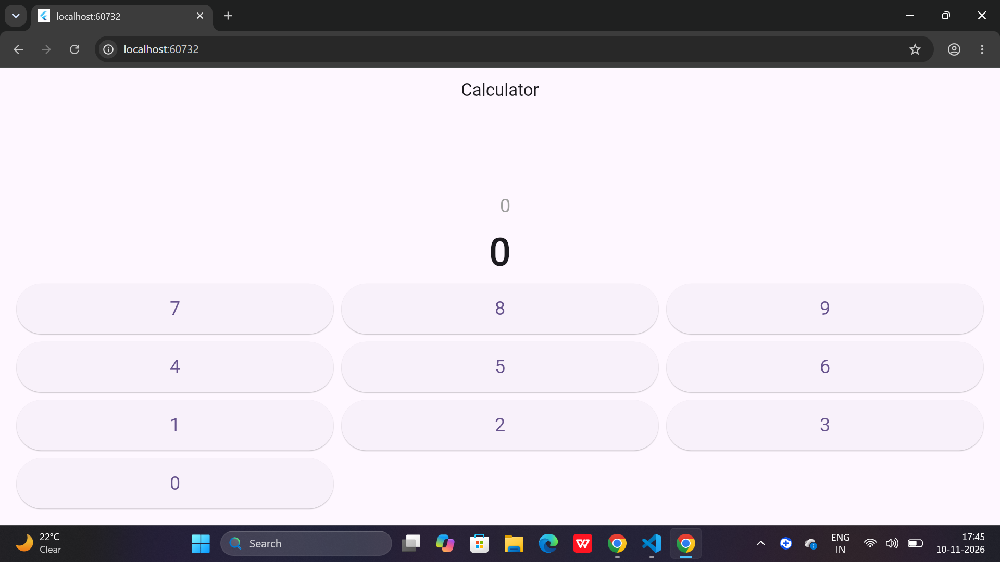

# Flutter Calculator App

## Project Description
A simple calculator application developed using Flutter and Dart.

## Features
- Number input buttons (0-9)
- Addition, subtraction, multiplication and division
- Clear button
- Delete button
- Displays calculation results
- Handles division by zero
- Attractive purple user interface

## Technologies Used
- Flutter
- Dart
- Visual Studio Code

## Application Screenshot

## How to Run
1. Install Flutter SDK.
2. Open the project folder in VS Code.
3. Run `flutter pub get`.
4. Run `flutter run -d chrome`.

## Developer
Ankitha

## Project
Flutter Calculator App
